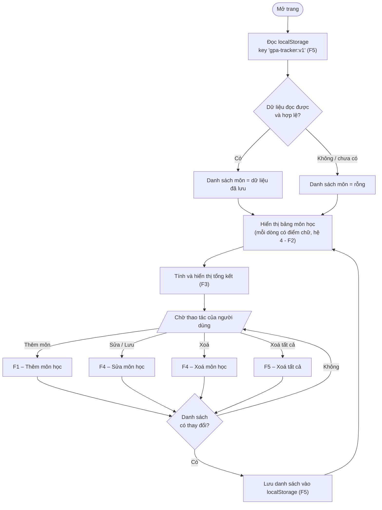
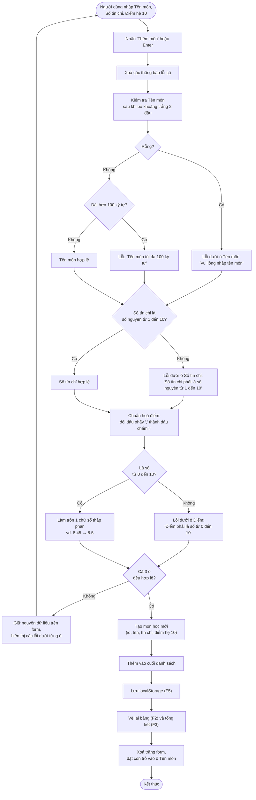
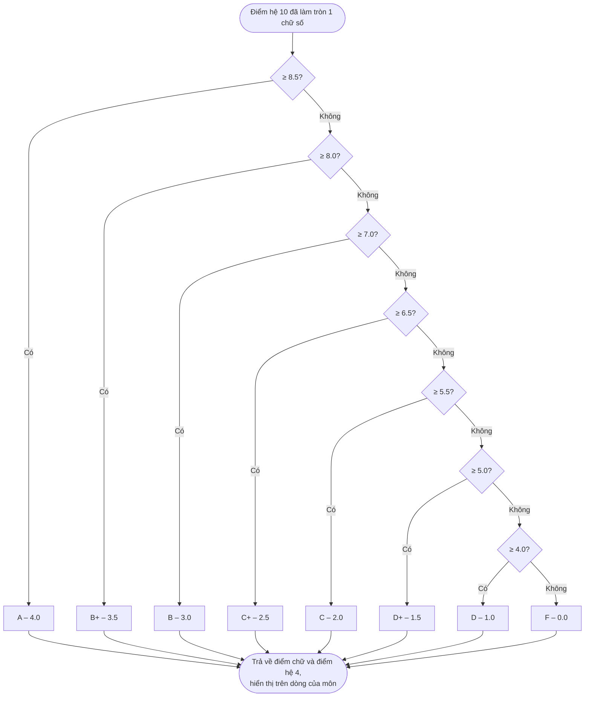
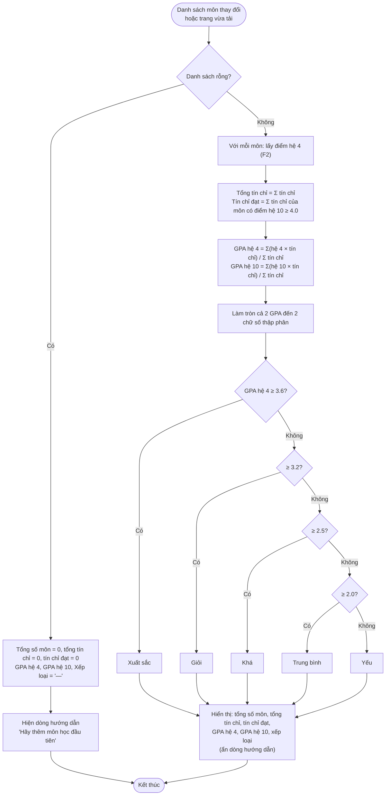
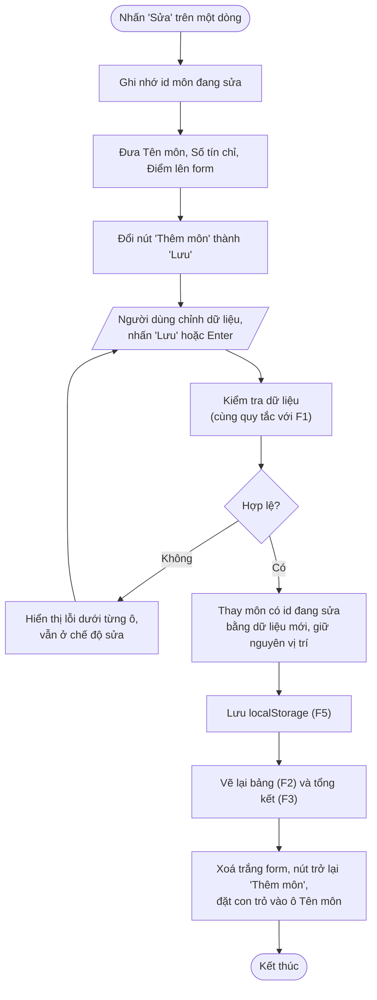
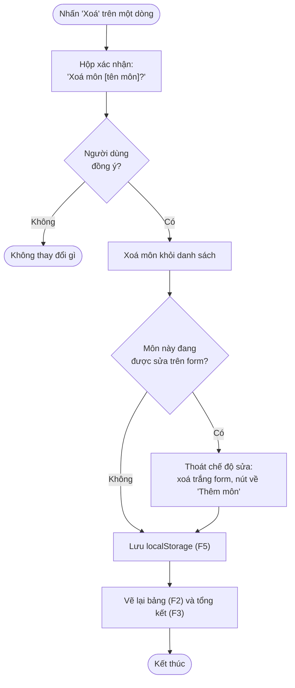
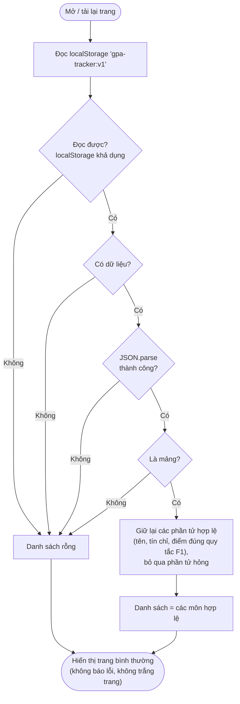
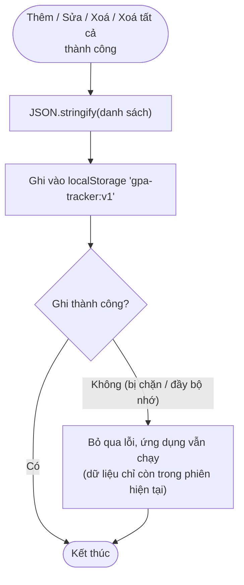
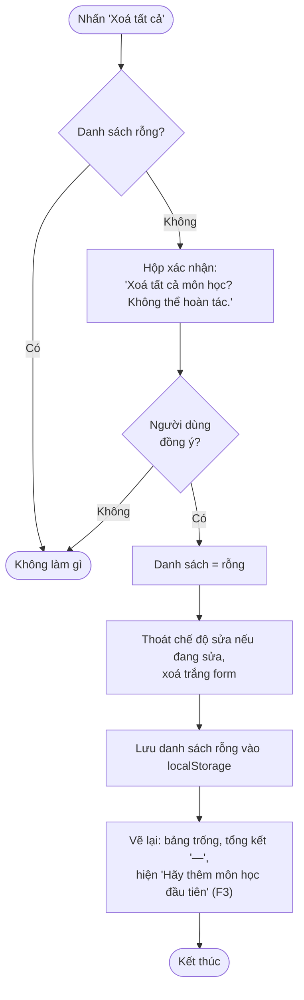

# Thiết kế luồng nghiệp vụ – GPA Tracker

Tài liệu giai đoạn 2 (Waterfall). Mỗi sơ đồ bám theo `PRD.md`; chỗ nào PRD chưa nói rõ thì được ghi ở mục **Điểm cần anh yêu duyệt** cuối tài liệu.

## 0. Luồng tổng thể của ứng dụng

## 1. F1 – Thêm môn học

> Cả 3 ô được kiểm tra trong một lần nhấn, nên người dùng thấy **tất cả** lỗi cùng lúc thay vì sửa từng lỗi một.

## 2. F2 – Quy đổi điểm

Đầu vào là điểm hệ 10 **đã làm tròn 1 chữ số** (bước F3 của F1), nên không có giá trị rơi vào khe giữa các mốc (vd. 8.45 đã thành 8.5).

## 3. F3 – Tính GPA và xếp loại

> Xếp loại dùng GPA hệ 4 **đã làm tròn** 2 chữ số (đúng với con số người dùng nhìn thấy).

## 4. F4 – Sửa và xoá môn học

### 4a. Sửa môn

### 4b. Xoá môn

## 5. F5 – Lưu dữ liệu

### 5a. Tải dữ liệu khi mở trang

### 5b. Lưu khi có thay đổi

### 5c. Xoá tất cả

## Điểm cần anh yêu duyệt

Những chỗ PRD chưa quy định rõ, sơ đồ trên đang chọn như sau:

1. **Kiểm tra cả 3 ô cùng lúc** khi nhấn Thêm/Lưu và hiện mọi lỗi một lượt (F1).
2. **Xếp loại dựa trên GPA hệ 4 đã làm tròn** 2 chữ số (F3).
3. **Không có nút "Huỷ" khi sửa** (PRD không yêu cầu). Nếu xoá chính môn đang sửa hoặc "Xoá tất cả" thì form tự thoát chế độ sửa (F4, F5).
4. **Dữ liệu lưu bị hỏng một phần:** giữ các môn hợp lệ, bỏ các phần tử hỏng. Hỏng toàn bộ thì về danh sách rỗng (F5).
5. **"Xoá tất cả" khi danh sách đang rỗng:** không làm gì, không hỏi xác nhận (F5).
6. **Hộp xác nhận** dùng `window.confirm` của trình duyệt cho đơn giản.
