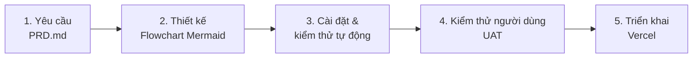

# Kế hoạch dự án – GPA Tracker

Mô hình phát triển: **Waterfall**. Mỗi giai đoạn phải hoàn thành (và được duyệt nếu có ghi chú) trước khi sang giai đoạn tiếp theo.

## Giai đoạn 1 – Phân tích yêu cầu
- [x] Viết `PRD.md` (chức năng F1–F5, quy tắc validation, bảng quy đổi điểm, yêu cầu phi chức năng)

**Sản phẩm:** `PRD.md`
**Điều kiện hoàn thành:** PRD được chốt.

## Giai đoạn 2 – Thiết kế luồng nghiệp vụ
- [x] Luồng tổng thể của ứng dụng (khởi động → tải dữ liệu → hiển thị)
- [x] F1 – Thêm môn học (nhập, validation, báo lỗi, thêm vào bảng)
- [x] F2 – Quy đổi điểm (hệ 10 → điểm chữ → hệ 4)
- [x] F3 – Tính GPA và xếp loại (kể cả trường hợp chưa có môn)
- [x] F4 – Sửa và xoá môn học (kể cả xác nhận xoá)
- [x] F5 – Lưu/tải dữ liệu localStorage (kể cả dữ liệu hỏng, Xoá tất cả)
- [x] Anh yêu duyệt thiết kế

**Sản phẩm:** `docs/flowcharts.md` (cú pháp Mermaid `flowchart`)
**Điều kiện hoàn thành:** Anh yêu duyệt toàn bộ flowchart.

## Giai đoạn 3 – Cài đặt và kiểm thử tự động
- [x] Khởi tạo dự án Vite (JS thuần) + cấu hình Vitest
- [x] F1 – Thêm môn học + unit test validation
- [x] F2 – Quy đổi điểm + unit test (đủ các mốc biên: 3.9/4.0, 4.9/5.0, 5.4/5.5, 6.4/6.5, 6.9/7.0, 7.9/8.0, 8.4/8.5, 10)
- [x] F3 – Tính GPA, xếp loại + unit test (làm tròn, danh sách rỗng, tín chỉ đạt)
- [x] F4 – Sửa/xoá môn + unit test
- [x] F5 – Lưu localStorage + unit test (dữ liệu hỏng, Xoá tất cả)
- [x] Giao diện responsive (≥ 360px), tiếng Việt
- [x] Toàn bộ test pass, `npm run build` thành công

**Sản phẩm:** mã nguồn + bộ unit test Vitest
**Điều kiện hoàn thành:** tất cả test pass, build thành công.

## Giai đoạn 4 – Kiểm thử người dùng (UAT)
- [ ] Claude chuẩn bị checklist UAT theo từng chức năng F1–F5
- [ ] **Anh yêu thực hiện kiểm thử** trên bản build/dev server
- [ ] Ghi nhận lỗi/góp ý vào `status.md`, sửa và kiểm thử lại
- [ ] Anh yêu xác nhận UAT đạt

**Điều kiện hoàn thành:** anh yêu xác nhận đạt (Claude không tự đánh dấu).

## Giai đoạn 5 – Triển khai
- [ ] Kết nối repo với Vercel và cấu hình build (Vite → `dist/`)
- [ ] Deploy production, kiểm tra nhanh trên URL công khai
- [ ] Ghi URL công khai vào `status.md`

**Sản phẩm:** URL công khai trên Vercel
**Điều kiện hoàn thành:** ứng dụng chạy ổn định trên URL công khai.
